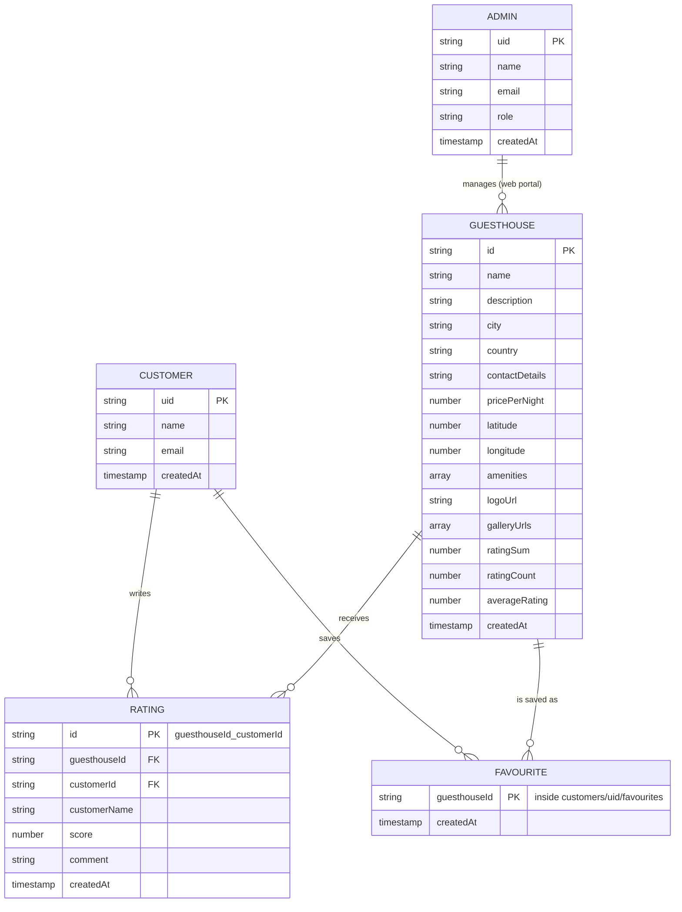

# Mi Casa Es Su Casa: Database Documentation

The web admin portal and the mobile app share one database. This document describes what is stored, how the pieces connect, and who is allowed to change what.

## 1. Technology and why we chose it

| Part | Choice | Reason |
|---|---|---|
| Database | Cloud Firestore (NoSQL, document based) | The brief asks for a NoSQL database. Firestore updates quickly, works from both React and React Native, and needs no server of our own for the mobile app. |
| Login | Firebase Authentication (email and password) | Same project as the database, so a logged-in user's `uid` can be used directly in the data and the security rules. |
| Images | Firebase Storage (used by the web portal) | The database only holds the image URLs. The mobile app never uploads. |

Guesthouse details are stored as one document, with amenities and gallery images as arrays inside it. A guesthouse is almost always read as a whole, so this avoids the joins a relational design would need.

## 2. Collections at a glance

```
guesthouses/{guesthouseId}
ratings/{guesthouseId}_{customerId}
customers/{customerId}
    favourites/{guesthouseId}
admins/{adminId}
```

`customerId` and `adminId` are the Firebase Authentication `uid` of that person. Every ID is a string.

## 3. Entity diagram



## 4. Collection details

### 4.1 `guesthouses/{guesthouseId}`

One document per guesthouse. Created and edited by admins in the web portal.

| Field | Type | Notes |
|---|---|---|
| `name` | string | Required. |
| `description` | string | Required. |
| `city` | string | Required. The dashboard counts guesthouses per city. |
| `country` | string | Required. |
| `contactDetails` | string | Required. Phone number, for example `+267 71 234 567`. |
| `pricePerNight` | number | Required. Always saved in **BWP (Pula)**. The mobile app converts it for display. |
| `latitude` | number | Required. Google Maps coordinate, for example `-24.6282`. |
| `longitude` | number | Required. For example `25.9231`. |
| `amenities` | array of strings | For example `["Wifi", "Parking", "Pool"]`. The mobile app also accepts a comma-separated string. |
| `logoUrl` | string | URL of the logo image. |
| `galleryUrls` | array of strings | URLs of the gallery images. |
| `ratingSum` | number | Total of all scores. Starts at `0`. |
| `ratingCount` | number | How many customers have rated. Starts at `0`. |
| `averageRating` | number | `ratingSum / ratingCount`, or `0` when nobody has rated. The dashboard reads this for "highest rated". |
| `createdAt` | timestamp | Set when the guesthouse is created. Used for "added this month". |

Extra fields such as number of rooms or check-in time can be added by the web team. The mobile app ignores fields it does not know.

### 4.2 `ratings/{guesthouseId}_{customerId}`

One document per customer per guesthouse. Written by the mobile app.

| Field | Type | Notes |
|---|---|---|
| `guesthouseId` | string | Which guesthouse was rated. |
| `customerId` | string | Who rated it. Must equal the logged-in user's `uid`. |
| `customerName` | string | Copied from the customer so reviews can show a name without another lookup. |
| `score` | number | Whole number from 1 to 5. |
| `comment` | string | Optional, can be empty. |
| `createdAt` | timestamp | Time of the last save. Editing a review refreshes it. |

The document ID is built from the guesthouse and the customer. That makes a second rating from the same person land on the **same document**, so it replaces the first instead of adding a duplicate.

### 4.3 `customers/{customerId}`

Created by the mobile app when someone signs up.

| Field | Type | Notes |
|---|---|---|
| `name` | string | Full name from the sign-up form. |
| `email` | string | Same email used to log in. |
| `createdAt` | timestamp | Sign-up time. |

### 4.4 `customers/{customerId}/favourites/{guesthouseId}`

One tiny document per saved guesthouse. The ID is the guesthouse ID, so a guesthouse can only be saved once. Removing a favourite deletes the document.

| Field | Type | Notes |
|---|---|---|
| `createdAt` | timestamp | When it was saved. |

### 4.5 `admins/{adminId}`

Used by the web portal. Having a document here is what makes a logged-in user an admin. The mobile app does not read it.

| Field | Type | Notes |
|---|---|---|
| `name` | string | Shown on the Admin Users screen. |
| `email` | string | Login email. |
| `role` | string | `owner` or `admin`. |
| `createdAt` | timestamp | When the admin was added. |

The first admin has to be added by hand in the Firebase console. After that, admins create each other through the portal.

## 5. How ratings are calculated

When a customer saves a rating, the app runs one **transaction** that does two things together:

1. Writes the rating document.
2. Updates the totals on the guesthouse.

| Situation | What happens to the totals |
|---|---|
| First rating from this customer | `ratingSum + score`, `ratingCount + 1` |
| Customer changes an earlier rating | `ratingSum - oldScore + newScore`, `ratingCount` stays the same |

Then `averageRating = ratingSum / ratingCount`. A transaction is used so that two people rating at the same moment cannot overwrite each other's change.

## 6. What the mobile app asks the database

| Screen | Query |
|---|---|
| Explore | Read every document in `guesthouses`. Search and sorting then happen on the phone. Default order is `pricePerNight`, lowest first. |
| Guesthouse details | Read one `guesthouses` document, and the `ratings` where `guesthouseId` equals that guesthouse. |
| Saved | Read `customers/{uid}/favourites`, then match the IDs against the guesthouses. |
| Rate a guesthouse | Transaction described in section 5. |
| Heart button | Create or delete a document in `customers/{uid}/favourites`. |

Search is done on the phone because Firestore cannot search for text inside a field. That is fine at the size of this project. If the data grew into the thousands, a search service would be needed.

No composite indexes are required. Reviews are sorted newest first after they are loaded, not in the query.

## 7. Security rules

| Collection | Anyone | Logged-in customer | Admin |
|---|---|---|---|
| `guesthouses` | read | update only `ratingSum`, `ratingCount`, `averageRating` | create, edit, delete |
| `ratings` | read | create or edit their own (ID must match their `uid`, score 1 to 5) | delete |
| `customers/{uid}` and `favourites` | none | read and write their own only | none |
| `admins` | none | none | read, create, edit, delete |

The full rules are in `firestore.rules`.

**Development rules:** while building, `firestore.dev.rules` opens the whole database until **3 November 2026**, then it locks. Use it to add sample data and test. Replace it with `firestore.rules` before the demo.

## 8. Environment variables

The mobile app reads these from a `.env` file. Use the placeholders below in the README and never commit the real values.

```
EXPO_PUBLIC_FIREBASE_API_KEY=your-api-key
EXPO_PUBLIC_FIREBASE_AUTH_DOMAIN=your-project-id.firebaseapp.com
EXPO_PUBLIC_FIREBASE_PROJECT_ID=your-project-id
EXPO_PUBLIC_FIREBASE_STORAGE_BUCKET=your-project-id.firebasestorage.app
EXPO_PUBLIC_FIREBASE_MESSAGING_SENDER_ID=your-sender-id
EXPO_PUBLIC_FIREBASE_APP_ID=your-app-id
```

## 9. Setting up the database from scratch

1. Create a Firebase project and register a **Web** app.
2. Turn on **Authentication > Email/Password**.
3. Create **Firestore Database**.
4. Publish `firestore.dev.rules` under Firestore > Rules.
5. Add four sample guesthouses: `node --env-file=.env scripts/seed.mjs`
6. Create the first admin by hand: add a document in `admins` whose ID is that user's `uid`.
7. Before the demo, publish `firestore.rules`.

## 10. Code that talks to the database (mobile)

| File | Job |
|---|---|
| `src/firebase.ts` | Connects to the project using the `.env` values. |
| `src/services/guesthouses.ts` | Guesthouses, reviews and favourites. |
| `src/services/auth.ts` | Sign up, log in, log out. |
| `src/context/AuthContext.tsx` | Keeps track of who is logged in and their favourites. |
| `scripts/seed.mjs` | Adds the sample guesthouses. |
