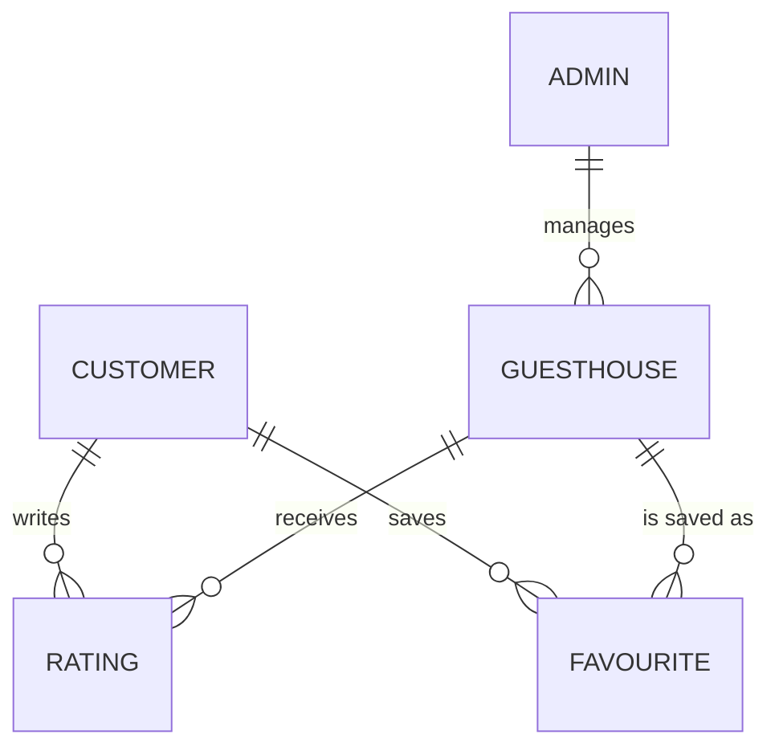

# Mi Casa Es Su Casa: project documentation

A guesthouse **discovery** platform in the style of Airbnb, built for the BIUST group project
"Guesthouse Discovery Platform". It has two parts that share one Firebase database:

| Part | Who uses it | Folder |
|---|---|---|
| Admin portal (website) | Admins: add and manage guesthouses, see the dashboard, moderate customers and reviews | `web/` |
| Customer app (Android / iOS) | Customers: browse, search, filter, save favourites, rate | `mobile/` |

There is **no booking or payment anywhere**, as the brief requires.

---

## 1. Tech stack and why

| Layer | Choice | Why |
|---|---|---|
| Web frontend | React 19 + TypeScript, Vite, Tailwind CSS | The brief requires React and TypeScript. Vite makes it fast to build; Tailwind keeps styles next to the markup. |
| Web server | Node.js + Express (`web/server.ts`) | Serves the built website. In development it runs Vite. |
| Backend / database | Firebase: Firestore (NoSQL), Authentication, Security Rules | The brief asks for a NoSQL database. Firestore works the same from React and React Native, updates live, and its **security rules are our server-side checks** (who may write what), so no extra API server is needed. |
| Image hosting | Cloudinary (free plan) | Firebase Storage needs a paid plan now. Cloudinary hosts the photos; Firestore stores their web addresses. |
| Mobile app | React Native with Expo (SDK 57), expo-router, TypeScript | One codebase for Android and iOS, and the same language as the web app, so the whole team can read both. |
| Maps | Leaflet + OpenStreetMap | Free and needs **no API key** (web Map View and the mobile Map tab). |
| Exchange rates | open.er-api.com | Free, no key. Built-in backup rates are used offline. |

---

## 2. API keys and environment variables

Real values go in `.env` files, which are **never committed** (they're in `.gitignore`).
Copy each `.env.example` to `.env` and fill it in.

### 2.1 Web: `web/.env`

| Variable | Where to find it | Secret? |
|---|---|---|
| `VITE_FIREBASE_API_KEY` | Firebase console > Project settings > Your apps > Web app | No (see note) |
| `VITE_FIREBASE_AUTH_DOMAIN` | same place, e.g. `your-project.firebaseapp.com` | No |
| `VITE_FIREBASE_DATABASE_URL` | same place (optional) | No |
| `VITE_FIREBASE_PROJECT_ID` | same place | No |
| `VITE_FIREBASE_STORAGE_BUCKET` | same place | No |
| `VITE_FIREBASE_MESSAGING_SENDER_ID` | same place | No |
| `VITE_FIREBASE_APP_ID` | same place | No |
| `VITE_CLOUDINARY_CLOUD_NAME` | Cloudinary dashboard, "Cloud name" | No |
| `VITE_CLOUDINARY_UPLOAD_PRESET` | Cloudinary > Settings > Upload > Upload presets (Signing mode **Unsigned**) | No |

### 2.2 Mobile: `mobile/.env`

| Variable | Same value as |
|---|---|
| `EXPO_PUBLIC_FIREBASE_API_KEY` | `VITE_FIREBASE_API_KEY` |
| `EXPO_PUBLIC_FIREBASE_AUTH_DOMAIN` | `VITE_FIREBASE_AUTH_DOMAIN` |
| `EXPO_PUBLIC_FIREBASE_PROJECT_ID` | `VITE_FIREBASE_PROJECT_ID` |
| `EXPO_PUBLIC_FIREBASE_STORAGE_BUCKET` | `VITE_FIREBASE_STORAGE_BUCKET` |
| `EXPO_PUBLIC_FIREBASE_MESSAGING_SENDER_ID` | `VITE_FIREBASE_MESSAGING_SENDER_ID` |
| `EXPO_PUBLIC_FIREBASE_APP_ID` | `VITE_FIREBASE_APP_ID` |

### 2.3 Services that need no key

OpenStreetMap map tiles, Leaflet (loaded from unpkg / npm), and open.er-api.com exchange rates.

### 2.4 Is it safe that these keys are in the app?

- Firebase web keys only say **which project** to talk to. They are built into every Firebase app and
  anyone can read them. What protects the data is **`firestore.rules`**, which the server enforces.
- The Cloudinary upload preset only allows uploading images. The Cloudinary **API secret** is never used
  anywhere in this project and must never be added.
- Never put a real secret in a variable that starts with `VITE_` or `EXPO_PUBLIC_`: both are copied into
  the app that users download.
- The removed AI chatbot's `GEMINI_API_KEY` is no longer used. Delete it from your `web/.env`.

---

## 3. Setting up and running

You need Node.js 20 or newer and a Firebase project with **Email/Password** sign-in switched on.

### 3.1 Firebase, once

1. Firebase console > Build > **Firestore Database** > Create.
2. Build > **Authentication** > Sign-in method > Email/Password > Enable.
3. Deploy the security rules:
   ```bash
   cd web
   npx firebase-tools login
   npx firebase-tools deploy --only firestore:rules
   ```
4. Make the first admin: Authentication > Add user (email + password). Copy its **User UID**.
   Then in Firestore make the document `admins/<that UID>` with fields `name`, `email` and
   `role` = `Owner`. After that, admins can add more admins from the website (Admins page).

### 3.2 Web admin portal

```bash
cd web
npm install
npm run dev
```
Open http://localhost:3000 and log in with the admin you made.
Checks: `npx tsc --noEmit`, `node scripts/test-suspension.cjs`, `npm run build`.

### 3.3 Mobile app

```bash
cd mobile
npm install
npx expo start
```
Scan the QR code with the **Expo Go** app, or press `w` to open it in a browser.

**APK for Android** (built on Expo's servers, free account):
```bash
cd mobile
npx eas-cli@latest login
npx eas-cli@latest build -p android --profile apk
```

### 3.4 Demos with no setup

`demos/mobile-demo.html` and `demos/admin-demo.html` run with fake data. Double-click to open them in a
browser. Mobile demo accounts: `demo@micasa.app` / `password123`, and the suspended customer
`suspended@micasa.app` / `password123`.

---

## 4. The data (Firestore collections)

Full details and the entity diagram: [`DATABASE.md`](DATABASE.md).

```
guesthouses/{guesthouseId}            name, logoUrl, galleryUrls[], description, amenities[],
                                      latitude, longitude, pricePerNight (BWP), city, country,
                                      contactDetails, ratingSum, ratingCount, averageRating, isSuspended
ratings/{guesthouseId}_{customerId}   score 1-5, comment, customerName, isHidden (one per customer)
customers/{uid}                       name, username, email, photoUrl, isSuspended
customers/{uid}/favourites/{ghId}     saved guesthouses
admins/{uid}                          name, email, phone, role (Owner or Admin)
```



**Security rules** (`web/firestore.rules`, the same copy is in `mobile/`):
- Anyone may read guesthouses and ratings. Only admins may add, edit, suspend or delete guesthouses.
- A customer may write only their own rating, scored 1 to 5, and only while not suspended.
- Suspended customers can browse but **can't save, rate or review**. Only admins can suspend.
- Customers can read and change only their own profile and favourites.

---

## 5. Mobile app: what each file does

Every file starts with a comment saying what it is. Longer screens have `---- section ----` comments.

| File (in `mobile/src/`) | What it is |
|---|---|
| `app/_layout.tsx` | First file the app runs: providers, moving background, screen list, splash screen |
| `app/(tabs)/_layout.tsx` | The bottom tab bar |
| `app/(tabs)/index.tsx` | **Explore**: search, filter button, list (cheapest first) |
| `app/(tabs)/map.tsx` | **Map**: price pins, tap for a card, "Fit all" |
| `app/(tabs)/spotlight.tsx` | **Spotlight**: TikTok-style full-screen feed of the top 5 rated |
| `app/(tabs)/saved.tsx` | **Saved**: favourites (log in needed) |
| `app/(tabs)/profile.tsx` | **Profile**: picture, username, suspended badge, settings, log out |
| `app/guesthouse/[id].tsx` | Guesthouse page: photos, details, amenities, contact, map, reviews |
| `app/auth/login.tsx`, `register.tsx` | Log in (with forgot password) and sign up |
| `app/settings.tsx`, `themes.tsx` | Settings (theme, currency) and the themes list |
| `components/` | Reusable pieces: cards, skeletons, splash, filter sheet, background, stars, avatar |
| `context/AuthContext.tsx` | Who is logged in, favourites, suspension, log in / out |
| `context/ThemeContext.tsx` | Chosen theme. Screens use `useColors()` |
| `context/SettingsContext.tsx` | Currency and `formatPrice()` |
| `context/ToastContext.tsx` | Short messages at the top, e.g. "Saved to favourites" |
| `services/guesthouses.ts`, `auth.ts` | All Firestore and Firebase Auth calls. Screens never call Firebase directly |
| `theme.ts` | All colours and the 18 themes |
| `utils/` | Search and filters, currencies, map page, amenity icons |
| `firebase.ts` | Connects to Firebase using `mobile/.env` |

How the pieces talk: **screen → context (shared state) → service → Firebase**. For example, tapping the
heart calls `toggleFavourite` in `AuthContext`, which calls `services/guesthouses.ts`, which writes to
`customers/{uid}/favourites`.

## 6. Mobile app features

- **Splash screen** with the MS logo (Matlhogonolo), then loading skeletons (Beatrice).
- **Explore:** search by name, city or country. The filter button opens sort (cheapest, most expensive,
  top rated), max price and minimum rating, with a live "Show N stays" count. **Cheapest is first by default.**
- **Map:** OpenStreetMap price pins, a card for the tapped pin, "Fit all", and "Show on the map" from a guesthouse.
- **Spotlight:** a vertical, snapping feed of the 5 best-rated guesthouses, with save, reviews, share and map buttons.
- **Guesthouse page:** photo gallery, logo, rating, price in your currency, amenities with icons, tap-to-call,
  "Show on the map" / "Open in Google Maps", and reviews.
- **Accounts:** sign up (name, username, email, password), log in, forgot password, stay logged in.
- **Logged in:** save favourites, rate 1-5 with a comment (one review each, editable), profile picture
  from the camera or gallery.
- **Suspension:** if an admin suspends you, saving and reviewing stop **straight away** (live), with a notice.
- **Look and feel:** 18 colour themes (4 free, the rest after logging in), a slowly drifting background,
  a smooth colour fade when you switch themes, and toasts.
- **Currency:** BWP, USD, EUR, GBP, ZAR and more, picked automatically from your location, changeable in Settings.

## 7. Web admin portal features

Login (admins only), **Dashboard** (live stats), **Guesthouses** (add, edit, suspend with Undo, delete),
**Map View**, **Reports** (charts, CSV export), **Admins** (add admins with their own login),
**Customers & Reviews** (suspend customers, hide or delete reviews), **Profile** (name, phone, password),
**Settings**. Saving a guesthouse gives up after 20 seconds with "Failed to upload guesthouse".
Loading buttons, toasts, the confirm box and skeletons follow the Figma "loading states and feedback" design.

---

## 8. Does it meet the brief?

✅ = done  ⚠️ = done with a note  ❌ = **your group still has to do this**

### Part 1: Web application

| Requirement | Status | Where |
|---|---|---|
| Frontend in React + TypeScript | ✅ | `web/src` |
| NoSQL database | ✅ | Firestore |
| Backend of your choice | ⚠️ | Firebase (Auth, Firestore, rules) + Express server (`web/server.ts`). Be ready to explain why rules replace a custom API (section 1). |
| Admins can log in | ✅ | `pages/Login.tsx`, checks `admins/{uid}` |
| A logged-in admin can create more admins **with login rights** | ✅ | `pages/AdminUsers.tsx`. **Fixed today:** before, it only saved a record and the new admin couldn't log in. It now creates a real login with a temporary password. |
| Register a guesthouse: name, logo, gallery, description, amenities, Google Maps coordinates, price, city, country, contact | ✅ | `pages/AddEditGuesthouse.tsx` (photos to Cloudinary) |
| Dashboard: total guesthouses | ✅ | `pages/Dashboard.tsx` |
| Dashboard: city with the most guesthouses | ✅ | `topCity` in `services/api.ts` |
| Dashboard: most highly rated guesthouse | ✅ | `highestRated` in `services/api.ts` |
| Extra statistics (encouraged) | ✅ | Average price per city, suspended count, Reports page |

### Part 2: Mobile application

| Requirement | Status | Where |
|---|---|---|
| Any framework | ✅ | React Native / Expo |
| Reads the same data the admins register | ✅ | Same Firestore `guesthouses` collection, live |
| View guesthouses without logging in | ✅ | Explore, Map, Spotlight, guesthouse page |
| Search by location or name | ✅ | `utils/search.ts` |
| Sort with filters, including price and rating | ✅ | `components/FilterSheet.tsx` |
| Cheapest first by default | ✅ | `DEFAULT_FILTERS` in `utils/search.ts` |
| Create an account and log in | ✅ | `app/auth/` |
| Logged in: save favourites | ✅ | heart button, Saved tab |
| Logged in: rate each guesthouse | ✅ | guesthouse page, reviews |
| No booking anywhere | ✅ | There is no book or pay button |

### Deliverables

| Deliverable | Status | Note |
|---|---|---|
| Full source code, web (frontend and backend) | ✅ | `web/` |
| NoSQL schema / collection structure | ✅ | `DATABASE.md`, section 4 above |
| Full source code, mobile | ✅ | `mobile/` |
| Short README for each part (stack, setup, env vars with placeholders) | ✅ | `web/README.md`, `mobile/README.md` (written today), `.env.example` files use placeholders |
| Data model / entity diagram (guesthouses, admins, customers, ratings) | ✅ | `DATABASE.md` (Mermaid diagram, shows on GitHub) |
| Live demo or demo video of both parts | ❌ | Record it yourselves. Suggested order is in section 9. |
| Contribution log (who did what) | ❌ | `CONTRIBUTION_LOG.md` is started from the git history. **Fill in student numbers and check it.** |
| Every member's name and student number in the README | ❌ | Fill in the table at the top of `README.md`. |
| Submit the GitHub link with both projects | ❌ | After you commit and push (nothing has been pushed). |

### Before you submit

1. **Deploy the Firestore rules** (section 3.1, step 3). Without them the server doesn't enforce suspension.
2. Add the Cloudinary values to `web/.env`, then add one guesthouse with photos to test it.
3. Fill in the names and student numbers (`README.md`, `CONTRIBUTION_LOG.md`).
4. Check that no `.env` file is committed: `git status` must not list one.
5. Record the demo video.

## 9. Suggested demo (about 5 minutes)

1. Web: log in, Dashboard (total, top city, top rated).
2. Web: add a guesthouse with a logo and gallery, then show it appear in the app straight away.
3. Web: add a second admin, log out, and log in as them.
4. App: browse as a guest, search, open filters (cheapest first), Map, Spotlight.
5. App: sign up, save a favourite, rate a guesthouse, and show the dashboard's rating change.
6. Web: suspend that customer, and show that the app instantly blocks saving and reviewing.
7. App: switch themes (watch the background fade) and change the currency.
