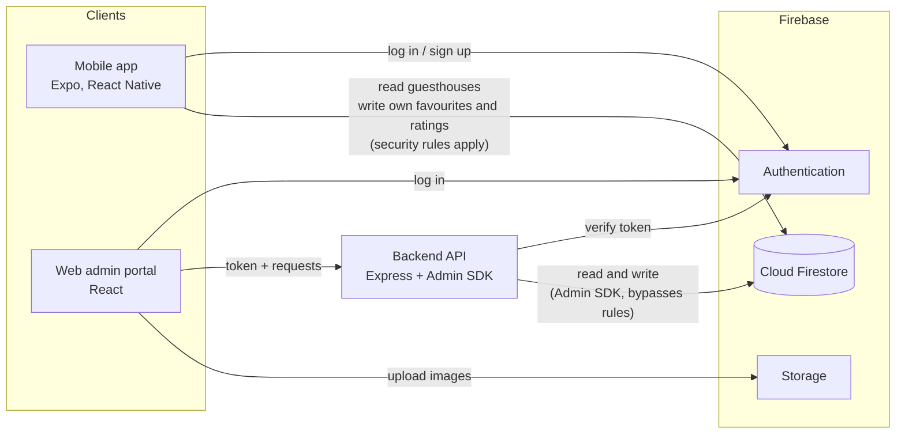
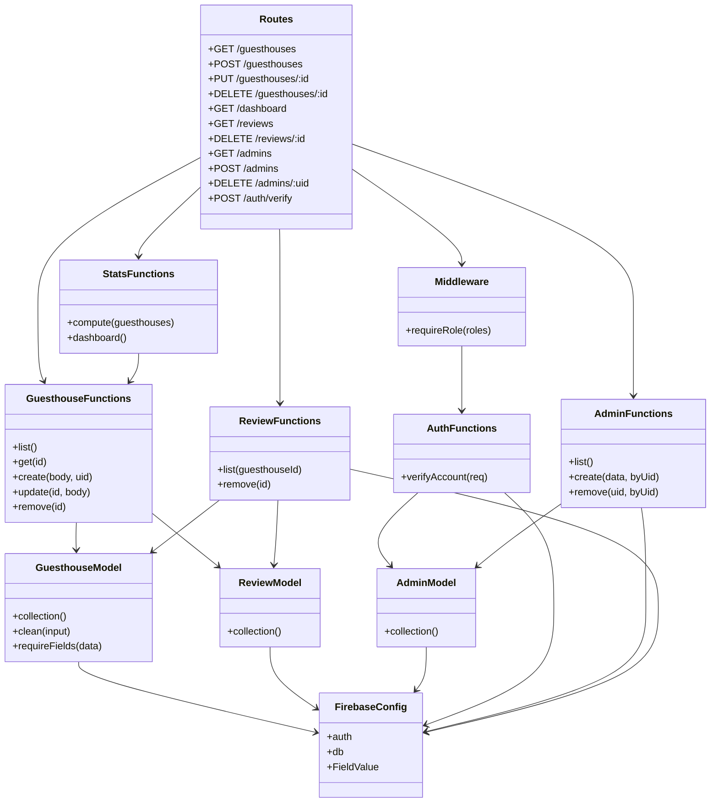
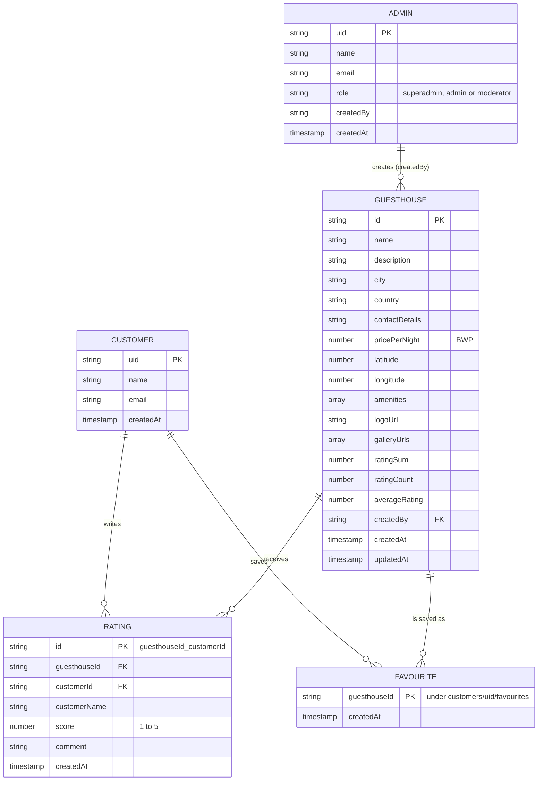
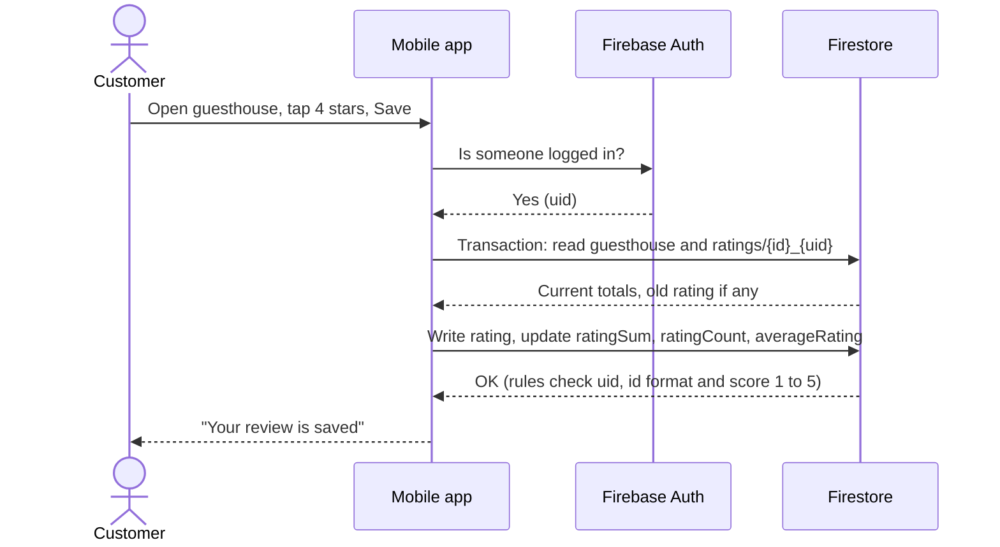
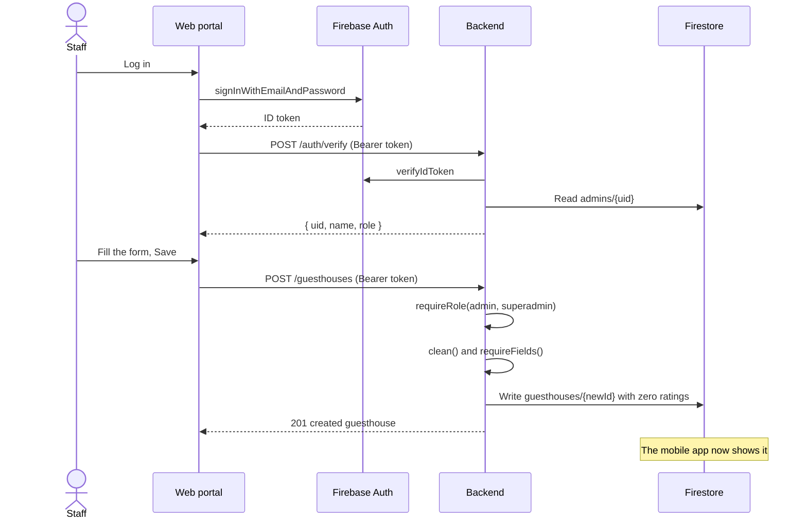
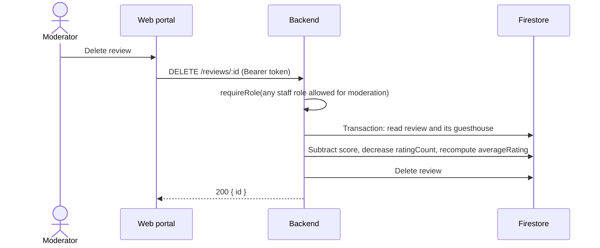
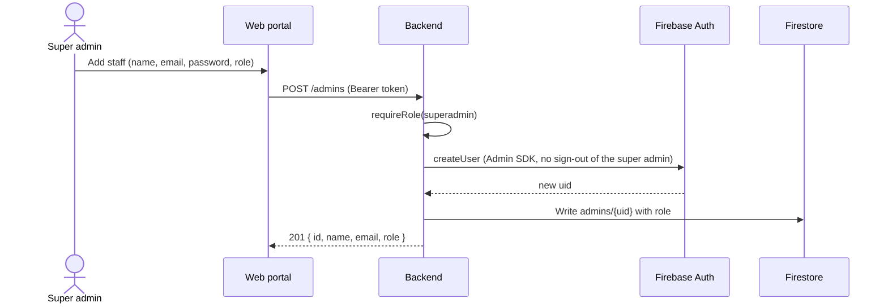

# UML diagrams

Diagrams are Mermaid. GitHub draws them when you open this file.

## 1. Architecture: how mobile, web and the back end connect

## 2. Backend structure (classes and modules)

## 3. Data model

## 4. Sequences

### 4.1 Customer rates a guesthouse (mobile to Firestore, no backend)

### 4.2 Staff member adds a guesthouse (web to backend to Firestore)

### 4.3 Moderator deletes a review

### 4.4 Super admin creates a staff account

