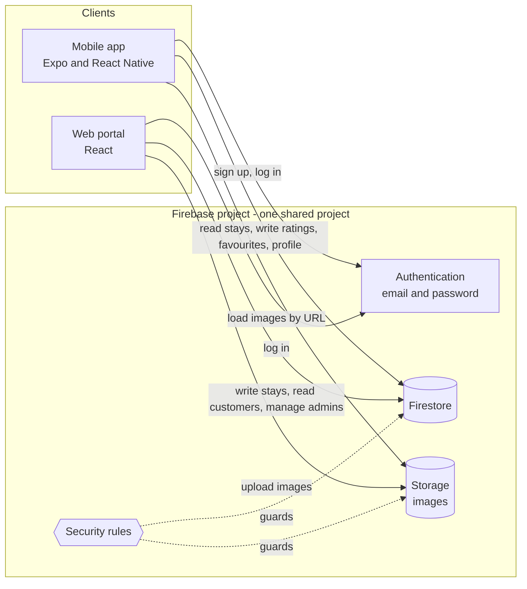
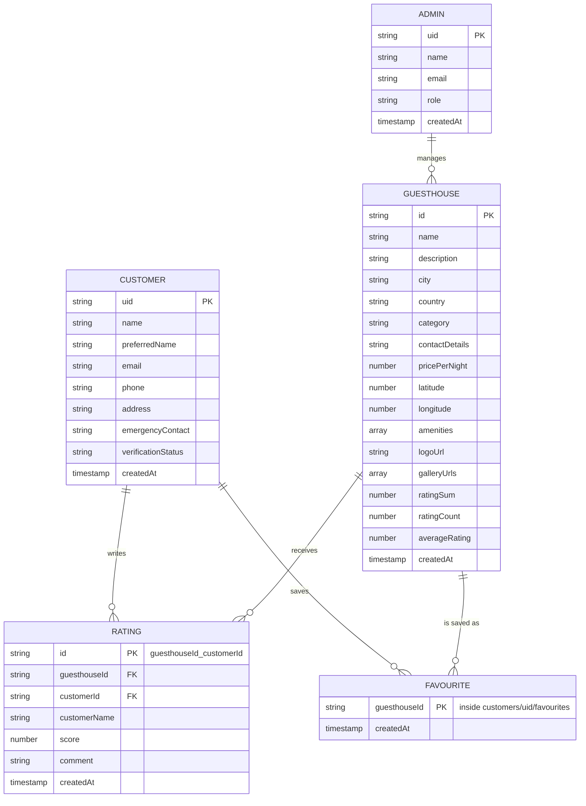
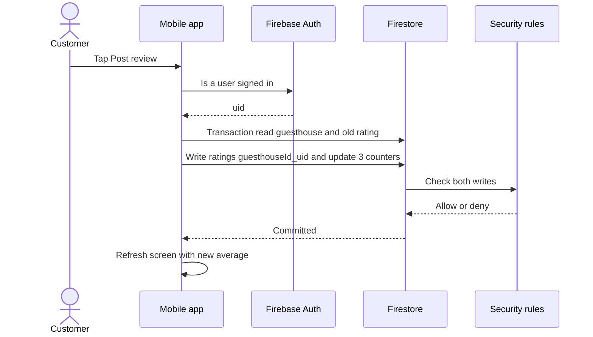
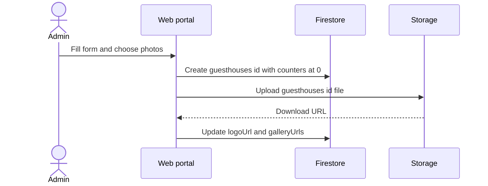
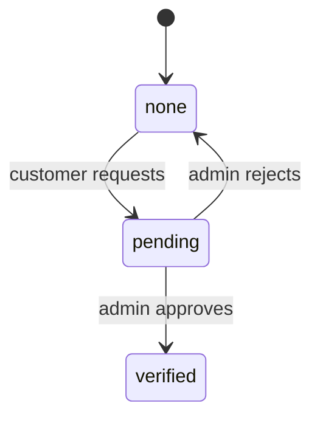
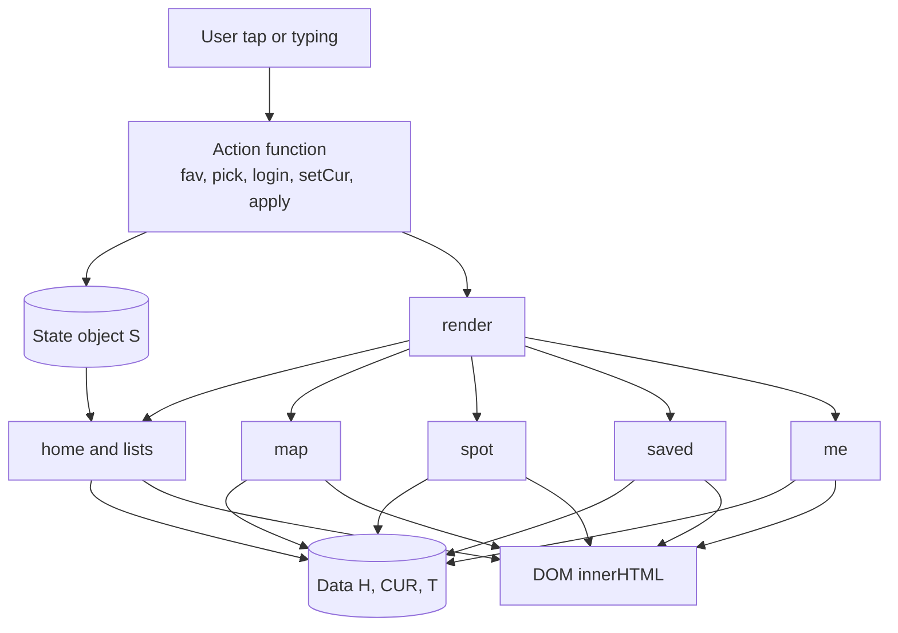

# UML

GitHub renders these Mermaid blocks in Markdown files [1].

## 1. Components

## 2. Data model

## 3. Sequence: customer posts a review (mobile)

## 4. Sequence: admin adds a guesthouse (web)

## 5. State: customer verification

The rules in `backend/firestore.rules` enforce these transitions. In the v8 demo this flow is not implemented (the Profile tab has no verification screen).

## 6. Mobile demo runtime

## Source

1. https://docs.github.com/en/get-started/writing-on-github/working-with-advanced-formatting/creating-and-highlighting-code-blocks
